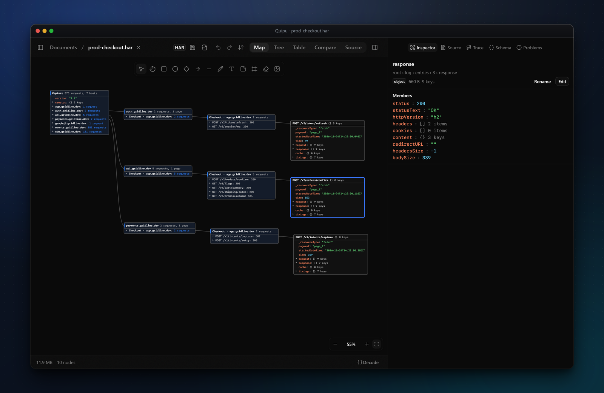

# Quipu

Open, search, decode, edit, diff, and inspect JSON and HAR files locally in the browser or desktop app. Tested up to a `2.00 GB` (`1.86 GiB`) HAR and `100 MiB` JSON, with a hard `4 GiB - 1 byte` source address limit. Renders with Canvas2D, SVG, and DOM, with no WebGPU requirement, no backend, and no accounts.



## When to use `jq` or DevTools instead

- Use `jq` or `rg` for files under a few dozen megabytes, scripted pipelines, and CI jobs where you already know the exact path you want.
- Use browser DevTools for live step-debugging and inspecting traffic while a tab is running.
- Use Quipu when you have a multi-hundred-megabyte or multi-gigabyte HAR or JSON dump on disk, nested base64 or stringified JSON payloads inside it, or edits you need to save back without copying the file into memory.

## What Quipu does

- **Linked views.** Switch between Map (HAR grouped by host, page, and request), virtualized Tree, virtualized Table (with a HAR request preset, SVG timing waterfall, and status-colored timeline scrubber), and byte-virtualized Source without losing your selection. Compare opens a two-document diff mode. (Converted read-only formats show an unlinked Source view.)
- **In-place decoding and deep search.** Decode nested stringified JSON, base64, data URLs, gzip streams, JWTs (marked unverified), GraphQL queries, URL-encoded forms, NDJSON, SVG and raster image previews, and HAR WebSocket frames per node, in bulk, or via per-kind auto-decode. Turn on **Deep decode** in the search bar to scan inside encoded payloads up to 8 stringified layers deep and inspect the decode chain.
- **Exact value tracing and match filtering.** Select any scalar to find every exact occurrence across a capture (including encoded payloads), grouped by HAR entry and section with optional transient trace arcs on the map. Toggle **Show matches only** to filter Tree, Map, and Table to matching nodes and their ancestors.
- **Search, JSONPath, and `jq`.** Parallel literal and regex search with worker timeouts, JSONPath queries including `[?(...)]` filter predicates, and `jq` (`jq-wasm 3.0.0`, bundling `jq 1.8.2`) either directly up to `64 MiB` or in per-element streaming mode across larger arrays and HAR captures.
- **Real editing and streaming export.** Edit JSON and HAR values, rename keys, edit subtrees (`F2`), sort objects or arrays, format, and minify with unlimited undo/redo and crash-recovery journals. Search works immediately after sorts and reformats without saving first. Export to JSON, YAML, TOML, XML, CSV, TSV, or NDJSON with pre-flight structural checks.
- **Diff, schema, and type generation.** Compare two JSON files structurally (with array identity matching and Myers LCS) or match HAR captures by `(method, url_without_fragment, _resourceType)` with `F7` stepping and inline body diffs. Infer shapes across every record, validate against local JSON Schema (draft 2020-12 and draft-07), and generate types for nine targets (TypeScript, Rust, Go, Python dataclasses, Python Pydantic, Kotlin, C#, Swift, and JSON Schema).
- **Map annotations and themes.** Draw shapes, sticky notes, freehand ink, and node-bound arrows on standalone boards or over the map, and export the visible or whole map to PNG or SVG (up to `8192 px`). Includes six named themes plus Graphite, a `7:1` contrast High Contrast palette, an OKLCH editor, and VS Code theme import.


## How it works

Quipu reads JSON and HAR files from disk in `8 MiB` slices (`Blob.slice` in the browser, `fs.read` over `MessageChannelMain` in Electron) instead of loading the entire file into memory. Up to 16 parallel `scan.worker` threads scan regions in two passes using dual-hypothesis string parity, then adopt the per-region arrays into a `SegmentedTape` (25 bytes per token, `Uint32Array` byte offsets up to `4 GiB - 1 byte`). Containers past the eager token budget store `1,024`-entry bucket anchors and index on demand when expanded.

Edits go into a zero-copy `PieceTable`, side-tapes, and crash-recovery journals stored in OPFS (browser) or `~/.quipu/userdata` (desktop). When OPFS is unavailable, in-place save (`detach()`) and transform spills fall back to an in-memory `Blob`. Search, path queries, `jq`, table views, and diffs read through the logical edited view. Multi-record operations (per-element `jq` across four pooled `jq-wasm` workers, streaming HAR capture diff, monoid-merged schema inference, and HAR validation) stream bounded `<= 64 MiB` child batches through `elementMap`.

## Measured performance

Measured on an Intel Core i9-14900 (32 threads, `62 GiB` RAM, Playwright Chromium `148.0.7778.96`, `1600x900`) against the production `apps/web/dist` build using cold browser launches and in-page `MutationObserver` timing:

| Fixture                                       | Metric                                        |                  Median | Range                    | Runs | Notes                                                          |
| --------------------------------------------- | --------------------------------------------- | ----------------------: | ------------------------ | ---: | -------------------------------------------------------------- |
| `100 MiB` JSON (`399,694` objects)            | First paint                                   |              `364.9 ms` | `342.0 to 372.1 ms`      |    5 | `421.8 ms` full tape index                                     |
| `100 MiB` JSON                                | Plain literal search (`3/3`)                  |               `44.4 ms` | `42.9 to 47.9 ms`        |    5 | `1.65 GiB` (`1,686 MiB`) base RSS                              |
| `100 MiB` JSON                                | Deep base64 search (`2/2`)                    |                `6.79 s` | `5.51 to 6.96 s`         |    5 | Every one of the `399,694` objects has a base64 field          |
| `100 MiB` JSON                                | Schema inference                              |              `662.3 ms` | `651.8 to 675.3 ms`      |    3 | Merges all `399,694` array elements in parallel                |
| `100 MiB` JSON                                | `jq` element mode (`3,997` hits)              |              `672.6 ms` | single run               |    1 | `51.1 MiB` jq worker heap                                      |
| `250 MB` (`238.4 MiB`) HAR (`5,334` entries)  | First paint / ready                           | `335.0 ms` / `399.1 ms` | `317.7 to 343.9 ms`      |    5 | `60.0 fps` pan                                                 |
| `250 MB` HAR                                  | Plain search (`4/4`) / deep (`2/2`)           | `184.0 ms` / `939.1 ms` | `888.1 to 1,016.1 ms`    |    5 | Finds base64 wrapping double-stringified JSON                  |
| `250 MB` HAR                                  | Table open / status sort                      |  `143.7 ms` / `43.9 ms` | `136.5 to 164.5 ms`      |    3 | `5,334` HAR rows                                               |
| `2.00 GB` (`1.86 GiB`) HAR (`40,398` entries) | First paint / ready                           |   `365.9 ms` / `1.60 s` | `1.32 to 1.78 s`         |    3 | `1.50 GiB` (`1,538 MiB`) pre-deep peak RSS                     |
| `2.00 GB` HAR                                 | Plain search (`4/4`)                          |                `1.46 s` | `1.45 to 1.46 s`         |    3 | `60.0 fps` pan                                                 |
| `2.00 GB` HAR                                 | Deep base64 search (`2/2`)                    |                `7.95 s` | `7.87 to 8.04 s`         |    3 | `2.34 GiB` (`2,401 MiB`) full-session RSS                      |
| `2.00 GB` HAR                                 | Live scalar edit                              |               `36.9 ms` | single run               |    1 | `PieceTable` edit on `entries[5].request.url`                  |
| `2.00 GB` HAR                                 | Table open / status sort                      |  `598.4 ms` / `37.5 ms` | `443.8 to 603.0 ms` open |    3 | `443.8 ms` on cool run 1; `598 to 603 ms` back-to-back         |
| `2.00 GB` HAR                                 | `jq` element mode (`.request.url`)            |                `8.15 s` | `6.79 to 8.15 s`         |    3 | `85.6 MiB` jq heap; isolates single `> 64 MiB` entry `#21114`  |
| Two `2.00 GB` HARs (`3.72 GiB` total)         | HAR capture diff (`40,397` same, `1` changed) |                `5.57 s` | `5.37 to 5.69 s`         |    3 | Includes opening File B; best-case 1-edit copy; `3.59 GiB` RSS |

Every run above recorded zero console errors and zero page errors. Two memory and timing details worth noting: base RSS on `100 MiB` JSON sits at `1.65 GiB` because Chromium holds up to 26 resident worker threads across scan, format, and `jq` pools, and deep search takes `6.79 s` on `100 MiB` JSON (versus `0.94 s` on `250 MB` HAR) because the synthetic JSON fixture places a base64 field on every single one of its `399,694` objects.

## Pairs with Hark

Quipu opens streaming HAR exports from [Hark](https://github.com/tretuttle/hark) directly, including out-of-order `entries` before `version`, response bodies over `3 MiB` encoded as `base64`, and `size: -1` missing-body annotations.

## Limits and requirements

- **Size limits.** Tested up to a `2.00 GB` (`1.86 GiB`) HAR and `100 MiB` JSON. `MAX_TAPE_SOURCE_BYTES` is `4 GiB - 1 byte` because tape offsets use `Uint32Array`.
- **Editable formats.** Only `JSON` and `HAR` are editable. Saving in place copies the open file to OPFS scratch (or an in-memory `Blob` when OPFS is unavailable) before overwriting. `YAML` and `TOML` parse whole up to `256 MiB` and open read-only alongside `JSONC`, `NDJSON`, `XML`, `CSV`, `TSV`, and plain text; converted formats show an unlinked read-only Source view.
- **64 MiB slice cap.** Single decoded strings, `F2` subtree edits, whole-document `jq`, inline HAR body diffs, and single elements in `jq` element mode cap at `64 MiB` (`MAX_SLICE_BYTES`). For larger JSON arrays or HAR files, `jq` offers per-element mode instead of materializing the file.
- **Diff and schema caps.** Generic structural JSON diff caps at `256 MiB` and refuses unexpanded tapes; HAR entry diff streams bounded batches up to the `4 GiB - 1 byte` source ceiling. JSON Schema validation refuses remote `$ref` (zero network fetches) and rejects `unevaluatedProperties` and `unevaluatedItems`.
- **Deep search is opt-in.** Because recursive base64 and gzip decoding runs about `5.5x` slower than plain search on a `2.00 GB` HAR (`7.95 s` versus `1.46 s`), **Deep decode** defaults to off and remembers your toggle state.
- **Cross-origin isolation.** The browser app requires `Cross-Origin-Opener-Policy: same-origin` and `Cross-Origin-Embedder-Policy: require-corp` so `SharedArrayBuffer` workers can run.
- **Privacy and CSP.** Both web and Electron builds ship a Content Security Policy (`default-src 'self'`, `script-src 'self' 'unsafe-inline' 'wasm-unsafe-eval'`, `connect-src 'self' blob: https://open-vsx.org https://openvsx.eclipsecontent.org`), contacting Open VSX only when you browse VS Code themes. The web E2E suite (`apps/web/e2e/privacy.e2e.ts`) verifies zero unexpected outbound requests.
- **Desktop builds.** Electron packages unsigned Linux `x86_64` AppImages on Linux (`vp run dist:desktop:linux`). Windows `x64` NSIS packaging is configured via `vp run dist:desktop:win` on Windows and is not pre-built yet. There is no macOS build.

## Build and run

Requires Node `24.21.0` and Vite+ (`vite-plus@1.0.0`), pinned in `mise.toml`.

```sh
git clone https://github.com/tretuttle/quipu.git
cd quipu
mise trust && mise install
vp i
```

Run locally:

```sh
vp run dev:web        # browser app with COOP/COEP headers
vp run dev:desktop    # Electron desktop app
vp run build          # web, desktop, and marketing builds
```

Verify:

```sh
vp run check          # format, lint, and typecheck across all 10 workspaces
vp run knip:check     # unused files, dependencies, and exports
vp run test           # unit tests across all packages and apps
vp run --filter @quipu/web test:e2e
vp run test:desktop-smoke
```

Package desktop binaries:

```sh
vp run dist:desktop:linux   # Linux x86_64 AppImage in release/
vp run dist:desktop:win     # Windows x64 NSIS installer (run on Windows)
```

## License

MIT. See [LICENSE](LICENSE). Third-party components and adapted codebases are credited in [THIRD_PARTY_NOTICES.md](THIRD_PARTY_NOTICES.md).
