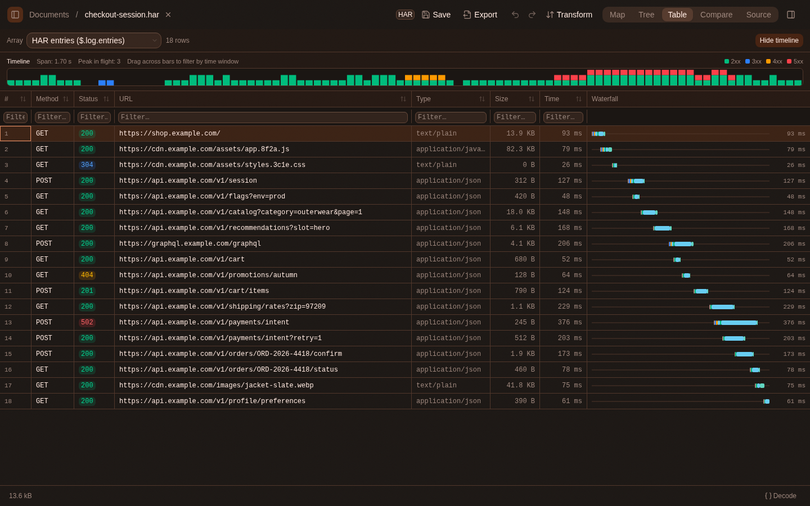
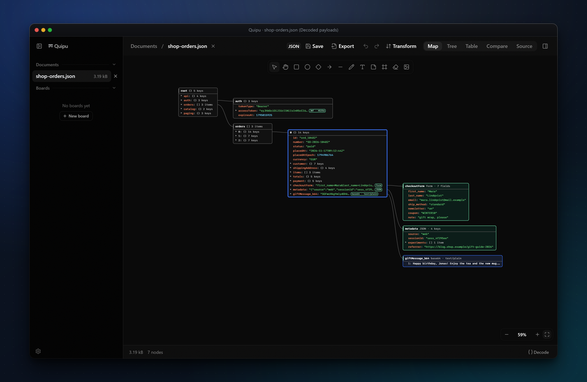

# Quipu

A local viewer and editor for large JSON and HAR files. It runs in the browser or as a desktop app, handles multi-gigabyte captures without loading the whole file into memory, and keeps everything on your machine.


Small files and scripted pipelines are still better off in `jq`, and live debugging belongs in browser DevTools. Quipu is for the large HAR dumps sitting on disk, nested base64 and double-escaped JSON buried inside response bodies, and edits you want to save back without blowing up RAM.

## What it does

### Linked views and HAR waterfall

You can switch between Map, Tree, Table, and Source while keeping the same node selected. On Map, HAR captures group by host, page, and request. In Table, HAR files open with per-column filters, an SVG timing waterfall, and a timeline scrubber you can drag to isolate a time window.



### Nested decoding and value tracing

Quipu decodes stringified JSON, base64, data URLs, gzip streams, JWTs, GraphQL queries, URL-encoded forms, NDJSON, images, SVG previews, and HAR WebSocket frames inline. You can decode one node, a selection, or turn on automatic decoding by type, and Quipu marks JWT signatures as unverified.

Turn on Deep decode in the search bar to scan inside encoded payloads up to 8 stringified layers deep and view the full decode chain. Select any scalar value to trace every exact occurrence across the capture, or filter Tree, Map, and Table down to matching nodes and their ancestors.



### Comparing captures and JSON files

Compare matches requests across two HAR captures by method, URL, and resource type, showing status filters, a change list, and inline JSON body diffs. Press F7 to step through changes. For plain JSON files, JSON Tree runs a structural diff with array identity matching and Myers LCS.


### Querying, editing, and schema tools

- **Search and queries.** Run parallel literal or regex search, JSONPath queries with `[?(...)]` filters, and `jq` either directly on files up to 64 MiB or element by element across larger arrays and HAR captures.
- **Editing and export.** Edit JSON and HAR values inline, rename keys, edit whole subtrees with F2, sort keys or arrays, format, and minify with unlimited undo, redo, and crash-recovery journals. Search stays accurate after sorts and reformats before you save. Export to JSON, YAML, TOML, XML, CSV, TSV, or NDJSON.
- **Schema and typegen.** Infer shapes across every record, validate against local JSON Schema draft 2020-12 or draft-07, and generate types for TypeScript, Rust, Go, Python dataclasses and Pydantic, Kotlin, C#, Swift, and JSON Schema.

### Boards and themes

You can sketch request flows on standalone boards or draw shapes, notes, and node-bound arrows directly over a map, then export the map to PNG or SVG up to 8192 px. Quipu ships with Graphite, six named palettes, a 7:1 High Contrast theme, an OKLCH theme editor, and VS Code theme import.


## How it works

Instead of reading a whole file into memory, Quipu reads 8 MiB slices from disk using `Blob.slice` in the browser or `fs.read` over Electron's `MessageChannelMain` on desktop. Up to 16 parallel scan workers index each slice in two passes, then assemble a `SegmentedTape` at 25 bytes per token with 32-bit byte offsets up to 4 GiB. Containers past the eager token budget store 1,024-entry bucket anchors and index on demand when you expand them.

Edits write to a zero-copy `PieceTable` with side-tapes and crash-recovery journals in OPFS on the web or `~/.quipu/userdata` on desktop. Search, queries, `jq`, tables, and diffs all read through that edited view. Large multi-record jobs, like per-element `jq`, HAR diff, schema inference, and validation, stream 64 MiB child batches through `elementMap`.

## Download

Download unsigned desktop builds for Windows x64 and Linux x86_64 AppImage from the [Releases](https://github.com/tretuttle/quipu/releases/latest) page, along with `SHA256SUMS.txt`.

## Build from source

### Requirements

### Windows & Linux

- Node.js 24.13.1+
- pnpm 11.10.0

```sh
git clone https://github.com/tretuttle/quipu.git
cd quipu
pnpm install
```

Run locally:

```sh
pnpm dev:web       # browser app
pnpm dev:desktop   # Electron desktop app
```

Build and package:

```sh
pnpm build                # build web, desktop, and marketing apps
pnpm dist:desktop:win     # Windows x64 NSIS installer (release/)
pnpm dist:desktop:linux   # Linux x86_64 AppImage (release/)
```

Tests and checks:

```sh
pnpm check                # format, lint, and typecheck
pnpm test                 # unit tests
pnpm test:e2e             # end-to-end tests
```

## License

MIT. See [LICENSE](LICENSE). [THIRD_PARTY_NOTICES.md](THIRD_PARTY_NOTICES.md) credits third-party dependencies and adapted codebases.
