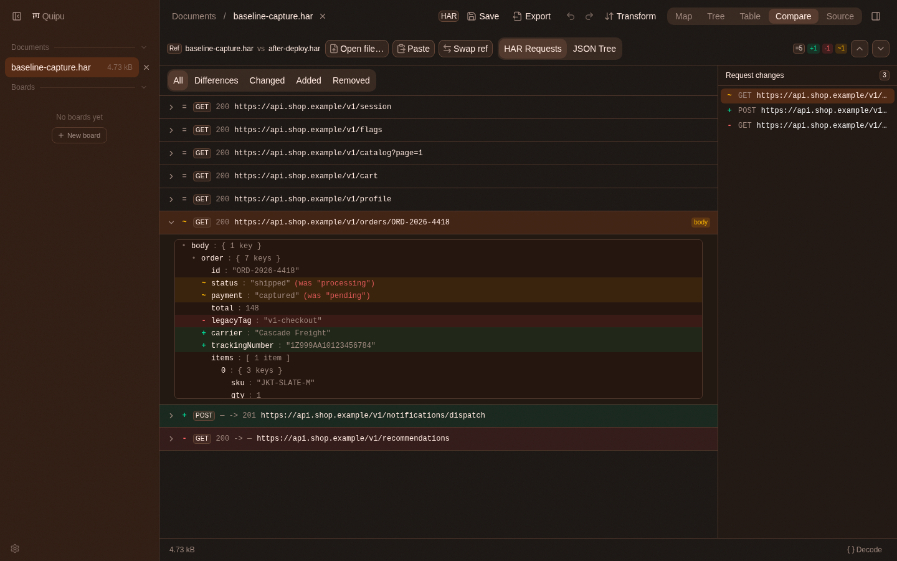
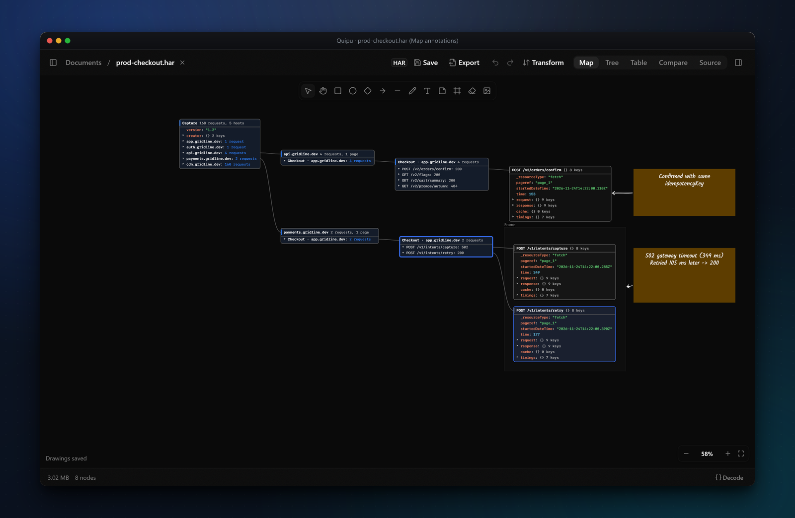

# Quipu

Open, search, decode, edit, diff, and inspect JSON and HAR files locally in the browser or desktop app. Tested up to a `2.00 GB` (`1.86 GiB`) HAR and `100 MiB` JSON, with a hard `4 GiB - 1 byte` source address limit. Renders with Canvas2D, SVG, and DOM, with no WebGPU requirement, no backend, and no accounts.


## When to use `jq` or DevTools instead

- Use `jq` or `rg` for files under a few dozen megabytes, scripted pipelines, and CI jobs where you already know the exact path you want.
- Use browser DevTools for live step-debugging and inspecting traffic while a tab is running.
- Use Quipu when you have a multi-hundred-megabyte or multi-gigabyte HAR or JSON dump on disk, nested base64 or stringified JSON payloads inside it, or edits you need to save back without copying the file into memory.

## What Quipu does

### HAR table, timing waterfall, and linked views

Switch between Map (HAR grouped by host, page, and request), virtualized Tree, virtualized Table, and byte-virtualized Source without losing your selection. For HAR files, Table includes per-column filters, an SVG timing waterfall, and a status-colored timeline scrubber you can drag to filter a time window.


### In-place decoding, deep search, and value tracing

Decode nested stringified JSON, base64, data URLs, gzip streams, JWTs (marked unverified), GraphQL queries, URL-encoded forms, NDJSON, SVG and raster previews, and HAR WebSocket frames per node, in bulk, or via per-kind auto-decode. Turn on **Deep decode** in the search bar to search inside encoded payloads up to 8 stringified layers deep and inspect the decode chain, select any scalar to trace every exact occurrence across a capture with optional map arcs, or toggle **Show matches only** to filter Tree, Map, and Table to matching nodes and their ancestors.


### HAR and structural JSON diff

Compare two HAR captures by `(method, url_without_fragment, _resourceType)` with status filters, a request change list, `F7` stepping, and inline JSON body diffs, or switch to **JSON Tree** to diff two JSON files structurally with array identity matching and Myers LCS.



### Querying, editing, schema, and export

- **Search, JSONPath, and `jq`:** Parallel literal and regex search, JSONPath queries with `[?(...)]` filter predicates, and `jq` directly up to `64 MiB` or in per-element streaming mode across larger arrays and HAR captures.
- **Editing and transforms:** Edit JSON and HAR values inline, rename keys, edit subtrees (`F2`), sort objects or arrays, format, and minify with unlimited undo/redo and crash-recovery journals. Search stays live after sorts and reformats without saving first.
- **Schema and type generation:** Infer shapes across every record, validate against local JSON Schema (draft 2020-12 and draft-07), and generate types for TypeScript, Rust, Go, Python (dataclasses and Pydantic), Kotlin, C#, Swift, and JSON Schema.
- **Streaming export:** Convert to JSON, YAML, TOML, XML, CSV, TSV, or NDJSON with pre-flight structural checks.

### Boards, map annotations, and themes

Sketch flows on standalone boards or annotate directly over a map with shapes, sticky notes, freehand ink, and node-bound arrows, then export the visible or whole map to PNG or SVG (up to `8192 px`). Includes Graphite plus six named themes, a `7:1` contrast High Contrast palette, an OKLCH theme editor, and VS Code theme import.



## How it works

Quipu reads JSON and HAR files from disk in `8 MiB` slices (`Blob.slice` in the browser, `fs.read` over `MessageChannelMain` in Electron) instead of loading the entire file into memory. Up to 16 parallel `scan.worker` threads scan regions in two passes using dual-hypothesis string parity, then adopt the per-region arrays into a `SegmentedTape` (25 bytes per token, `Uint32Array` byte offsets up to `4 GiB - 1 byte`). Containers past the eager token budget store `1,024`-entry bucket anchors and index on demand when expanded.

Edits go into a zero-copy `PieceTable`, side-tapes, and crash-recovery journals stored in OPFS (browser) or `~/.quipu/userdata` (desktop). When OPFS is unavailable, in-place save (`detach()`) and transform spills fall back to an in-memory `Blob`. Search, path queries, `jq`, table views, and diffs read through the logical edited view. Multi-record operations (per-element `jq` across four pooled `jq-wasm` workers, streaming HAR capture diff, monoid-merged schema inference, and HAR validation) stream bounded `<= 64 MiB` child batches through `elementMap`.

## Download

Prebuilt desktop binaries for Windows (`x64` installer) and Linux (`x86_64` AppImage) are available on the [Releases](https://github.com/tretuttle/quipu/releases/latest) page (unsigned; checksums in `SHA256SUMS.txt`).

## Build from source

### Requirements

### Windows & Linux

- Node.js `24.13.1+`
- pnpm `11.10.0`

```sh
git clone https://github.com/tretuttle/quipu.git
cd quipu
pnpm install
```

Run locally:

```sh
pnpm dev:web       # browser app
pnpm dev:desktop   # Electron desktop app
```

Build and package:

```sh
pnpm build                # build web, desktop, and marketing apps
pnpm dist:desktop:win     # Windows x64 NSIS installer (release/)
pnpm dist:desktop:linux   # Linux x86_64 AppImage (release/)
```

Tests and checks:

```sh
pnpm check                # format, lint, and typecheck
pnpm test                 # unit tests
pnpm test:e2e             # end-to-end tests
```

## License

MIT. See [LICENSE](LICENSE). Third-party components and adapted codebases are credited in [THIRD_PARTY_NOTICES.md](THIRD_PARTY_NOTICES.md).
